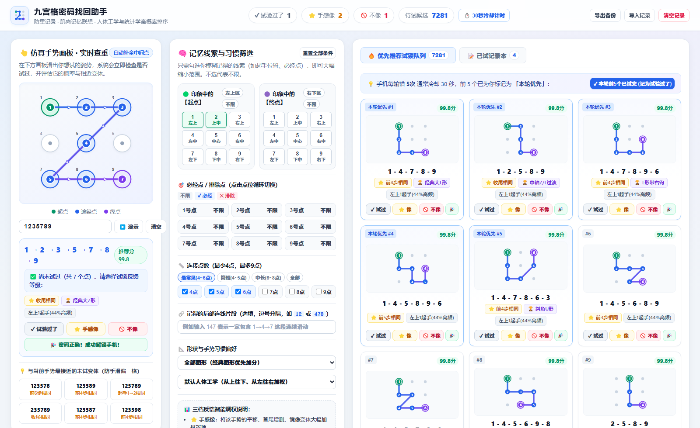
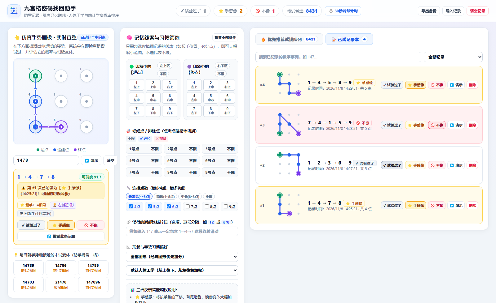

# 🔓 九宫格解锁密码找回助手 (Pattern Lock Recovery Assistant)

> 一个专为「忘记手机九宫格图案密码」设计的Web辅助工具：**1:1 仿真防重画板 + 模糊记忆线索筛选 + 统计学/人体工学/肌肉记忆三档智能推荐**。

🌐 **在线体验 (GitHub Pages)**：[https://arrake0101.github.io/unlock/](https://arrake0101.github.io/unlock/)

---

## 📸 界面预览

### 1. 智能优先推荐队列与仿真画板


### 2. 实时防重检测与三档已试记录本


---

## ✨ 核心特性

### 1. 👆 1:1 真机九宫格仿真画板与实时防重
- **共线中间点自动补全**：完全还原 Android / 手机锁屏规则（例如从 `1` 直接滑向 `3`，若中间点 `2` 尚未经过则自动连成 `1 → 2 → 3`；若 `2` 已经访问过则允许直接跨越）。
- **三层清晰轨迹可视化**：底层外圈光环、中层渐变连线与**线段中点方向箭头**、顶层带白边的实心步数序号（🟢 起点、🔵 途经点、🟣 终点），复杂交叉折返也能一眼看清滑法。
- **防重复试锁提醒**：手机每输错 5 次就会触发 30 秒冷却锁定。在画板滑出任意手势时，系统会**立即检测你是否已经试过**（并提示第几次尝试及当时的反馈等级），避免在同一个错误密码上浪费宝贵机会。
- **近邻变体直通车**：每次在画板画完一个手势，下方自动生成 6 个与它最接近的未试变体（防手滑偏一格或少拐一个弯）。

### 2. 🎯 三档试锁反馈与正负向肌肉记忆调权
针对每次试锁，提供三档精细反馈等级（外加 `🎉 解锁成功`），实时动态调整候选队列排序：
- **`⭐ 手感像`（正向联想加权）**：试了不对，但觉得滑动方向或手感很接近。系统会自动将该图案的**同形状平移变体**（如 `1-4-7-8` 平移为 `2-5-8-9`）、**首尾增删改 1 步变体**、**相同起手前缀**、**左右/上下镜像变体**大幅加权置顶。
- **`✓ 试验过了`（中性排除）**：普通试错记录，仅将该图案本身从待试推荐池中排除，不干扰其他候选图案权重。
- **`🚫 不像`（负向排斥降权）**：觉得完全不对劲的走向。系统不仅排除该图案，还会**自动扣分压低**与它同形状、同走向的近似图形排名，优先展示其他截然不同的形状。

### 3. 🧠 模糊记忆线索筛选器
哪怕只记得一点零星印象，勾选后即可过滤掉 80%~95% 的无关组合：
- **直观的 3×3 空间起点 / 终点选择器**：按手机屏幕真实方位（`1 左上`、`5 中心`、`9 右下` 等）多选印象中的起手或收尾区域。
- **必经点 / 排除点三态矩阵**：一键标记肯定经过（`✓ 必经`）或肯定没经过（`✕ 排除`）的点位。
- **连接点数与局部连线过滤**：支持按点数范围（常用 `4~6` 点或全部 `4~9` 点）、必含局部连线片段（如 `147`）、形状风格（经典字母符号 `L/Z/N/U/C/S/7/M/口`、排除“日”字斜跳步、仅看顺滑走势）及单手握持习惯筛选。

### 4. ⏱️ 配合手机冷却机制的批次辅助与本地持久化
- **本轮前 5 优先高亮 + 30 秒冷却计时器**：推荐列表自动高亮前 5 个为「本轮优先 #1~#5」，支持一键标记「本轮前5个已试完」并自动开启 30 秒冷却倒计时。
- **自动保存与 JSON 导入/导出**：所有试锁记录自动保存在浏览器 `localStorage` 中，刷新或关闭页面不丢失，并支持导出/导入 JSON 备份。

---

## 🛠️ 本地运行方式

本项目为纯前端零依赖构建，可通过以下任意方式运行：

### 方式一：直接双击打开
直接用浏览器打开项目根目录下的 `index.html` 即可完整使用全部功能。

### 方式二：使用内置 Node.js 静态服务启动
```bash
node server.js
# 访问 http://localhost:3000
```

---

## 📂 目录结构

```text
unlock/
├── index.html                   # 主页面（三栏响应式布局）
├── styles.css                   # 清爽亮色主题与九宫格轨迹样式
├── app.js                       # 九宫格几何引擎、启发式剪枝搜索与三档评分算法
├── server.js                    # 本地零依赖 HTTP 静态服务器
├── assets/
│   ├── screenshot-overview.png  # 主界面与智能推荐队列截图
│   └── screenshot-history.png   # 防重检测与已试记录本截图
└── README.md                    # 项目说明文档
```
